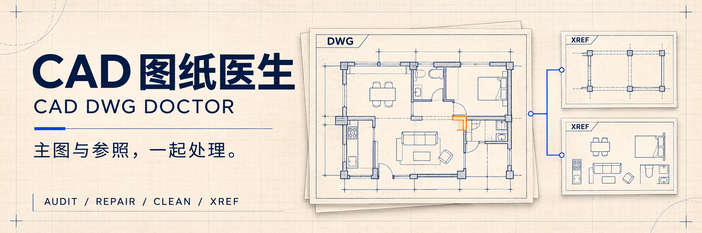
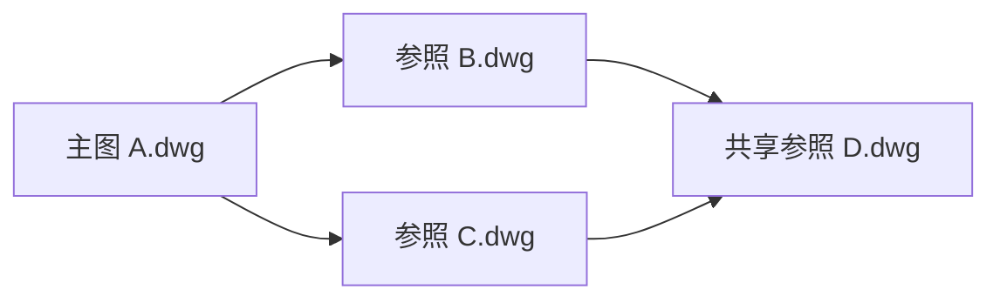

<p align="center">
  
</p>

<h1 align="center">CAD 图纸医生</h1>

<p align="center"><strong>给一张主图，连同参照一起检查、修复与清理。</strong><br>
保留原版本。需要覆盖时，先备份，再替换。</p>

<p align="center">
  <a href="https://github.com/ajchen01/cad-dwg-doctor/actions/workflows/validate.yml"></a>
  <a href="https://github.com/ajchen01/cad-dwg-doctor/releases"></a>
  
  
  <a href="LICENSE"></a>
</p>

<p align="center">
  <a href="https://github.com/ajchen01/cad-dwg-doctor/releases/tag/v0.1.0-beta.5"><strong>下载技能包</strong></a> ·
  <a href="#results">看真实效果</a> ·
  <a href="#install">安装</a> ·
  <a href="#commands">命令速查</a> ·
  <a href="#validation">验收与边界</a>
</p>

---

## 一句话，让整套图纸过一遍

把图纸医生安装到支持技能和本地脚本执行的 AI 助手中，就能用中文提出处理需求。本机 AutoCAD 负责读写图纸，技能负责串起检查、修复、参照处理和验收报告。

**核心能力与适用场景：** 图纸医生面向日常使用 AutoCAD 的设计师，支持 DWG 图纸体检、数据库错误修复、无用块与图层等资源清理、零长线与空文字清理，以及教育版打印戳记检查与清除。适合收到外部图纸后先做检查、处理图纸报错或冗余数据、批量整理历史图纸，以及交付前统一检查主图和参照。所有操作默认递归包含可解析的外部参照，保持每份 DWG 的原格式版本，输出处理报告；默认保留原文件，明确要求覆盖时先逐份备份并校验。它帮助完成图纸文件的检查与整理，设计内容及专业规范仍需设计师复核。

安装后，可以直接这样说：

```text
帮我检查这套图纸，保留原文件。图纸位置：D:\项目图纸\主图.dwg

修复并清理这套 DWG，保持每份图纸的原版本，给我前后对比。

清除这张主图及全部参照的教育版戳记。需要覆盖原文件，先备份并校验。
```

不用逐个列出参照。**从主图开始，默认递归所有可解析的 DWG 参照**，包括嵌套参照；共享文件在同一次任务中去重处理。

> **运行条件：Windows + Python 3.10+ + 已安装并激活的 AutoCAD。**
> 普通处理使用 AutoCAD 2020+；清戳需要 2022+ 内核。无须打开 CAD 界面，仍然需要本机 AutoCAD。

<a id="results"></a>

## 先看一次真实验收

下面是同一份合成 DWG 的清戳前后打印件。四边的 `AUTODESK` 水印消失，线、圆和文字保留；前后导出的 DXF 也核对了这三个实体的几何与文字属性。

<table>
  <tr>
    <th width="50%">处理前</th>
    <th width="50%">处理后</th>
  </tr>
  <tr>
    <td></td>
    <td></td>
  </tr>
</table>

<p align="center"><sub>公开样本衍生的合成图纸，不含客户数据。上方封面是项目示意图，此处为实际验收打印件。</sub></p>

这是一组样本的结果，不能代替所有图纸和布局的验收。完整记录见 [清戳与版本验收](docs/EDU-ACCEPTANCE-2026-11-25.md)，嵌套图集验证见 [参照验收](docs/XREF-ACCEPTANCE-2026-11-25.md)。

## 它会替你做什么

| 你遇到的问题 | 处理方式 | 你拿到什么 |
|---|---|---|
| 收到图纸，想先判断质量 | 读取 DXF 副本，分析图层、文字、几何、样式等 20+ 项 | 中文体检报告，含问题级别与定位线索 |
| 数据库报错、零长线、空文字 | 原生 `AUDIT` 修复，可清理零长线和空文字 | 修复成品与前后报告 |
| 无用块、图层、样式堆积 | 多轮原生 `PURGE`，统计处理前后变化 | 清理成品及实际变化记录 |
| 一套主图带多层参照 | 递归解析 DWG 依赖，共享文件去重 | 主图与参照的处理结果；条件满足时生成相对路径整包 |
| 怀疑存在教育版打印戳记 | 打印成 PDF，分析边条形态；2022+ 原生保存后复打 | 前后 PDF、PNG 与判定依据 |
| 想用成品替换原图 | 显式开启覆盖，先备份并核对 SHA-256 | 原位成品、独立备份及可追溯报告 |

详细检查项见 [体检规则清单](references/checklist.md)。图纸文件大小只作参考，处理效果看问题数、实体与符号表变化。

<a id="install"></a>

## 第一次使用，从这里开始

首次接触这类工具，可以考虑 **WorkBuddy**。图纸医生保持通用技能形式，使用的助手需要支持技能加载、本地文件访问和脚本执行；各工具兼容性需实际验证。

### 1. 添加图纸医生

从 [GitHub Releases](https://github.com/ajchen01/cad-dwg-doctor/releases) 下载 `cad-dwg-doctor.zip`，解压后将完整文件夹添加到你使用的助手中。保留脚本和参考资料，**不要只复制 `SKILL.md`**。具体导入入口或技能目录以所用工具说明为准。

### 2. 让助手检查运行环境

复制这句话：

> 请使用图纸医生，检查这台电脑能不能处理 DWG。先不要修改图纸；缺少运行组件时，帮我准备技能专用环境，并说明检查结果。

技能提供只读环境检查脚本，检查 Windows、Python、所需依赖和 AutoCAD 引擎。依赖可由助手协助准备；AutoCAD 需要你自行安装并激活。检查通过不代表已完成实际图纸验收。

### 3. 提供图纸位置，说出需求

> 请修复清理 D:\项目图纸\主图.dwg，包括全部外部参照。保留原文件，保持每份 DWG 的原版本，完成后告诉我成品和报告在哪里。

提供本地主图路径或完整图纸文件夹，保留原参照结构。默认输出副本；只有明确要求覆盖，才会逐份验证备份并替换。

完整说明、常见问题和结果示例见 **[第一次使用指南](references/getting-started.md)**。

<details>
<summary>手动安装与环境检查（熟悉命令行的用户）</summary>

Codex 默认目录示例：`%USERPROFILE%\.codex\skills\cad-dwg-doctor\`。其他工具使用各自规定的目录。

在技能目录执行，或让助手使用技能专用虚拟环境：

```powershell
python -X utf8 -m pip install -r requirements.txt
python -X utf8 scripts/check_environment.py
# 打印与清戳需额外检查依赖及引擎版本
python -X utf8 scripts/check_environment.py --mode strip --json
```

非标准 AutoCAD 安装位置可用 `--acc` 或 `ACCORECONSOLE` 指定；清戳引擎使用处理入口的 `--strip-acc`。环境检查不启动 AutoCAD，不验证激活或实际打印结果。

</details>

<a id="commands"></a>

## 命令速查

以下命令在技能目录执行，**默认均包含主图的全部可解析 DWG 参照**。

```powershell
# 只体检，保留原图
python scripts/dwgpipe.py audit "主图.dwg"

# 修复并清理，输出副本
python scripts/dwgpipe.py all "主图.dwg" --out "处理结果"

# 检查打印戳记
python scripts/eduprint.py check "主图.dwg"

# 清戳，前后打印验收，输出副本
python scripts/dwgpipe.py edustrip "主图.dwg"

# 明确覆盖：主图和参照逐份备份、校验后替换
python scripts/dwgpipe.py all "主图.dwg" --overwrite
python scripts/dwgpipe.py edustrip "主图.dwg" --overwrite

# 批量修复与清理
python scripts/batch_check.py "D:\图纸" --repair
```

| 可选参数 | 用途 |
|---|---|
| `--out "目录"` | 指定报告与成品位置，默认输出到 `dwg-check/` |
| `--overwrite` | 显式覆盖原文件；主图和参照分别备份、校验 |
| `--no-clean` | 保留零长线、空文字，只做原生修复和符号表清理 |
| `--timeout 1800` | 放宽单次 AutoCAD 会话超时 |
| `--no-xref` | 只在明确要求排除参照时使用 |
| `--xref-depth N` | 主动限制层数；仍有未处理依赖时返回失败 |

各入口使用 `--help` 查看完整参数。高级操作与历史排错记录见 [操作参考](references/operations.md)。

## 一张主图，沿参照关系处理整套 DWG



- **递归处理**：不局限于 `.Attach` 目录，按图纸保存的参照路径解析。
- **共享去重**：D 被两份图引用，也只处理一次；覆盖时只创建一份独立备份。
- **清戳顺序**：先处理参照，再处理宿主；复验打印使用本次处理后的参照快照。
- **完整性检查**：缺参照、发现失败或深度截断会返回失败，禁止覆盖不完整图集。

副本模式在路径条件满足时生成整包。含绝对路径或目录外依赖时，不保证整包可移植；具体结果写在报告中。

## 覆盖不是直接写回原图

**默认只生成副本。** 只有明确要求“覆盖原文件”，技能才会使用 `--overwrite`。

```text
副本处理 → 成品复验与版本核对 → 创建备份并核对哈希 → 原子替换
```

每份实际替换的 DWG，都在原文件旁留下独立备份：

```text
主图.dwg
主图.dwg.backup-20261125T104429518631Z-随机标识.bak
```

备份失败、哈希不一致、处理期间源文件变化、存在 CAD 锁文件、成品验收失败或版本不一致时，均不允许替换。旧备份保留，备份路径和哈希记录在报告中。

**输入 2010，就输出 2010；输入 2013，就输出 2013。** 主图和参照、普通修复和清戳都执行版本核验，无法保留原格式时失败。

批量覆盖按文件执行，不提供整批事务回滚；若后续文件失败，已完成的替换及其备份会保留。清戳覆盖必须经过前后打印，不能使用 `--verify none`。

<a id="validation"></a>

## 验收有记录，边界也写清楚

当前发布为 **`v0.1.0-beta.5` 预发布版**。42 项回归测试，以及 Windows Python 3.10 / 3.11 的 GitHub Actions 验证已通过；CI 不包含 AutoCAD，原生宿主测试另有记录。

| 已验证的场景 | 证据 |
|---|---|
| DWG 2010 / 2013 / 2018 清戳前后版本一致，成品可重开 | [清戳验收](docs/EDU-ACCEPTANCE-2026-11-25.md) |
| 三份 DWG 的嵌套图集：副本清戳、连参照覆盖、整包复查 | [参照验收](docs/XREF-ACCEPTANCE-2026-11-25.md) |
| 两张主图共享参照，仅产生四份唯一备份 | [共享参照与备份](docs/XREF-ACCEPTANCE-2026-11-25.md) |
| 备份失败、源文件变化、锁文件及替换失败等保护路径 | [发布验证记录](docs/RELEASE-READINESS.md) |

**使用前需要知道：**

- **循环参照**目前只有遍历去重，尚不自动解除循环，也未将循环单独列为覆盖阻断项。应先人工理清循环关系，再进行清戳或覆盖；循环遍历仅做过模拟测试。
- **打印识别是启发式检查**，可能误报或漏报，只覆盖本次输出页面。须结合 PDF / PNG 复核；未检出不证明文件的全部布局无戳，也不证明许可资格。
- **复杂客户工程图、第三方代理对象与多布局**仍待进一步验收。不能把公开、合成样本通过扩展成工程交付保证。
- **不做设计判断**，不自动删除重复或游离图元。严重损坏到无法打开的 DWG，需要先用 AutoCAD `RECOVER` 或查找历史备份。

退出码 `0` 表示处理流程成功，不等于图纸零错误或专业验收通过。有失败时返回非零并保留相应报告。

<details>
<summary>输出文件与故障定位</summary>

| 输出 | 内容 |
|---|---|
| `*-体检报告-修复前.md` / `*-体检报告-修复后.md` | 分级问题、概况及实体统计 |
| `*-已修复.dwg` / `*-已去戳.dwg` | 保持原格式的候选成品 |
| `*-report.json` / `batch.json` / `edustrip.json` | 结构化结果、失败信息、备份记录 |
| `打印验收/` | 清戳前后 PDF 与 PNG |
| `整包…/` | 条件满足时，按原相对路径组织的主图与参照 |

如果 AutoCAD 无法访问宿主沙箱的临时目录，在同一 PowerShell 会话中把 `$env:TEMP`、`$env:TMP` 指向可写且 AutoCAD 可读的 ASCII 路径。使用 `--keep-temp` 保留相应处理入口的中间文件。

详细入口：[技能说明](SKILL.md) · [检查规则](references/checklist.md) · [操作与排错](references/operations.md)。

</details>

---

[MIT License](LICENSE)。本项目非 Autodesk 官方产品，使用 AutoCAD 需满足相应许可条件；清除打印戳记不改变图纸的使用授权。

<sub>README 的展示结构参考了 <a href="https://github.com/alchaincyf/huashu-design">Huashu Design</a>：先讲用途，再用真实结果说明能力。封面为本项目生成，未使用参考项目的图片。</sub>
