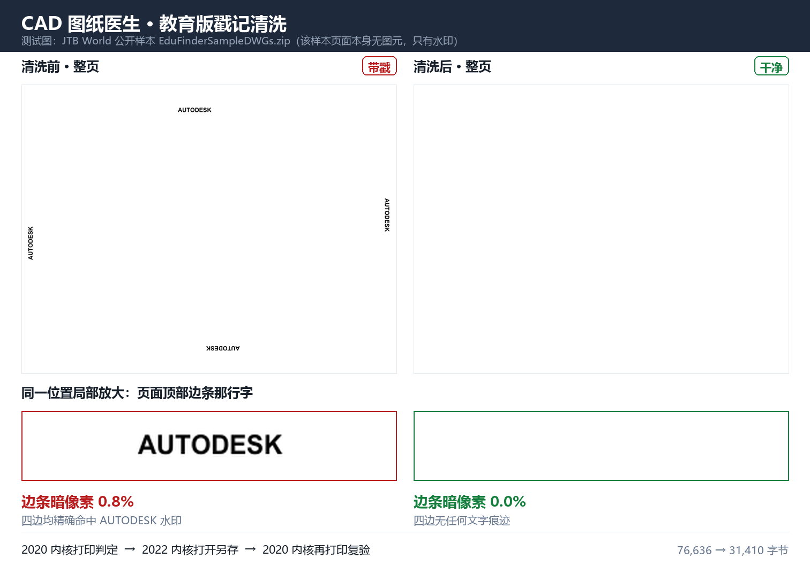

# CAD 图纸医生

**别人给的 DWG，先让它过一遍。**

体检 → 修复 → 清理 → 去教育版戳。全程无头调用 AutoCAD 的 `accoreconsole`，不弹界面、不用点鼠标，可以塞进批处理里对着一整个目录跑。

```bash
python scripts/dwgpipe.py audit "图纸.dwg"        # 只体检，不动文件
python scripts/dwgpipe.py all   "图纸.dwg"        # 体检 + 修复 + 清理
python scripts/eduprint.py check "图纸.dwg"       # 打印出来看有没有教育版水印
```

---

## 它解决什么问题

别人（设计院、甲方、协作方）发来的施工图，常见的四种病：

| 症状 | 病因 | 这个工具怎么办 |
|---|---|---|
| 打开报错、`ZOOM E` 后满屏一个点、捕捉总捕到怪点 | 数据库层有错误、零长线、游离图元 | `AUDIT` 修 + 删零长线 + 报告游离图元 |
| 几十 MB，一半是没人用的图层块样式 | 历史堆积 | 多轮 `-PURGE`，报告实体的真实变化 |
| 带一堆外部参照，只修主图等于白修 | xref | 参照一起处理，并拼成相对路径完好的整包 |
| 打印出来四边有 `AUTODESK` 水印 | 教育版 / 学生版画的 | 打印件比对判定（可信），2022+ 内核可清 |

前三条是纯粹的工程质量问题，第四条牵涉授权，单独说 —— 见 [教育版戳记](#教育版戳记)。

---

## 能做什么 / 不能做什么

**能**

- `AUDIT` 修复数据库层损坏（表记录错乱、句柄重复）
- 清理无用图层 / 块 / 线型 / 文字样式 / 标注样式 / 材质（多轮 `-PURGE`）
- 删零长线、空文字（纯 LISP，安全可回退）
- 20+ 项深度体检（见 [`references/checklist.md`](references/checklist.md)）
- 外部参照跟随处理，输出可直接打开的整包
- 教育版戳记：判定 + 清除（需 2022+ 内核）
- 中文 Markdown 报告、修复前后对比、批量总表

**不能**

- **修不好「彻底损坏」的文件**。`AUDIT` 修的是数据库结构，不是数据恢复。打不开的图要先 `RECOVER`，`RECOVER` 也失败就是真没了（找 `.bak` 或平台历史版本）
- **不动天正 / 探索者等自定义对象**。代理对象只能原样保留，无法编辑或转成基本图元
- **不做设计判断**。标注值对不对、标高合不合理、图框套没套对，这些是人的活
- **不自动删重复实体**。`OVERKILL` 在无头模式下会挂死会话（实测跑完不返回、后续 `QSAVE` 全不执行），所以只报告，让人在 GUI 里跑

---

## 安装

**平台：Windows**（`accoreconsole` 只有 Windows 版）。Python 3.9+。

```bash
pip install -r requirements.txt
```

**AutoCAD**：不需要 GUI，只要有 `accoreconsole.exe`（AutoCAD 2020 及以上自带，无需额外组件）。找一个：

```
1. 环境变量 ACCORECONSOLE   ← 绿色版 / 便携版 / 非标准安装用这个
2. C:\Program Files\Autodesk\AutoCAD 20xx\   （也会扫 D:、E: 盘的同名目录）
3. PATH
```

也可以在命令行用 `--acc <路径>` 直接指定。

---

## 三分钟上手

```bash
# ① 只体检，不动图。先看有没有问题，最常用
python scripts/dwgpipe.py audit "图纸.dwg"

# ② 体检 + 修复 + 清理，输出「已修复.dwg」和前后两份报告
python scripts/dwgpipe.py all "图纸.dwg" --out "输出"

# ③ 批量体检整个目录，出一张总表
python scripts/batch_check.py "D:\项目\图纸" --out "D:\项目\dwg-check"

# ④ 批量体检 + 修复
python scripts/batch_check.py "D:\项目\图纸" --repair
```

**修复永远发生在副本上，原图一个字节都不动。** 成品是 `<原名>-已修复.dwg`。

**退出码**：全部成功返回 `0`，有文件处理失败返回 `1` 并列出失败的文件名。批量跑和 CI 里可以直接用 `&&` 或 `if` 判断，不用去 grep 日志。

详细命令见 [`SKILL.md`](SKILL.md)，那里有完整参数表和踩过的坑。

---

## 教育版戳记

这是这个工具做得最深的一块，也是唯一有争议的一块。

### 判定：只能打印出来看

试过并且**全部证伪**的三条路：

| 方法 | 为什么不行 |
|---|---|
| 扫 DWG 字节找 `ACAD_EDU` / `Educational` | 数据段是压缩的，连 `AcDb:` 都搜不到。官方带戳样本里一个特征串都没有 |
| 扫导出的 DXF 明文 | 带戳和干净两张的 DXF 内容一模一样，戳不在文本层 |
| 无头开图抓「按 ENTER 键继续」 | 这行的真身是 **SYSVARMONITOR 的系统变量监控气泡**被压平出来的，跟教育版无关。补齐全部字体和参照后，干净图和带戳图弹得一字不差 |

现在唯一的判据是**打印**：把图打成 PDF → 渲染成位图 → 看页面最外 10% 的边条。

判据不是「边条有多黑」，而是「这条边是不是那行 `AUTODESK` 的字」：

| 特征 | 带戳的边条 | 图面内容伸进边条 |
|---|---|---|
| 连通块个数 | **6~10（正好 8 个字母）** | 3 块、26 块、47 块、271 块…… |
| 暗像素占比 | **0.6~0.8%（很稳）** | 0.22% / 0.65% / 0.87% / 9.4% |
| 沿边长度占比 | 8~15% | 5~100% |
| 分布 | 多条边同一行字，深浅一致 | 通常只在一两条边 |

只看比例必然误判 —— 实测有张干净图的图框让右边边条暗到 **9.4%**，比真水印黑十倍。按「暗像素 ≥0.10% 就算带戳」跑，16 张里误判 10 张；改成认形态后，29 张打印件回归：**真带戳 8/8、真干净 21/21、矛盾 0**。

```bash
python scripts/eduprint.py check "图纸.dwg" --out 报告目录
```

产物是 PDF + PNG，可以直接翻图核对，不用信脚本的结论。



> 上图用的测试图是 [JTB World 免费公开的 EduFinder 样本](https://jtbworld.com/edufinder)
> （`Drawing with stamp 2010 format.dwg`），不含任何客户数据。这个样本页面本身是空的、
> 一个图元都没有，四边照样有水印 —— 正好说明戳在文件头，不在图元里。

### 清除：只有 2022+ 官方路径

| 手段 | 实测结果 |
|---|---|
| DXF 往返（`DXFOUT` → `SAVEAS 2018`） | **仍带戳** |
| 商业版 AutoCAD 2020 另存 | **仍带戳** |
| 把图元全删光再另存 | **仍带戳**（戳是文件级的，不随内容走） |
| **AutoCAD 2022+ 打开另存** | **清掉** |
| DWG TrueView 2027 | **不可用**：`QSAVE`/`SAVEAS`/`DXFOUT` 全是 `Unknown command`，只读内核没有写盘路径 |

所以本工具的清戳流程就三步，不搞花活：

```bash
python scripts/dwgpipe.py edustrip "图纸.dwg"
```

1. **判定**（非教育版内核打印）→ 不带戳直接跳过，不动文件
2. **清戳**（2022+ 内核）→ 打开 →（可选 `AUDIT`）→ `QSAVE` 原地重写
3. **复验**（再打印一次）→ 还带戳就报「仍带戳，需人工」，**绝不假装成功**

每张都留清除前后的打印件在 `打印验收/`，这是能翻图复核的硬证据。

实测一套 16 张的住宅施工图（5 主图 + 11 参照）：**已清 8，本来就干净 8，失败 0**。

### 合规

教育版只授权教学使用，商用不符合 Autodesk 许可协议。带戳的图送审 / 交付会被退回。

**这个工具提供「判定」，主要用途是让收图方知道该把图退回去，要求出图方用正版重出。** 清除功能的存在，是为了处理「自己早年用学生版画的图」这类历史遗留。用它把别人教育版画的图洗白后交付，责任在使用者。

---

## 它是怎么做到的

三条设计原则，决定了代码长什么样：

**1. 体检读 DXF，修复写 DWG —— 绝不把 DXF 写回 DWG。**
DXF 往返会把天正 / 探索者的自定义对象降级成**代理块**，T20 的墙、门窗、设备全变成死块。所以结构分析靠 `DXFOUT` 出来的只读副本，所有修改都用 CAD 原生命令在 DWG 上做。

**2. 所有 CAD 侧操作跑在纯 ASCII 临时目录。**
`accoreconsole` 的 `/i` `/s` 参数遇到中文路径会按本地 ANSI 解坏（报「无法加载程序集」这类完全不指向真因的错误）。流水线自动把文件复制到 `%TEMP%` 下的 ASCII 目录作业，成品再拷回。

**3. 尺度判定用中位数，不用包围盒。**
图里只要有一个误粘贴的远点（跑到 x=1e8），包围盒就被撑爆，「超远坐标」和「极短图元」两条规则会同时自我失效。现在用「到中位中心距离的 90 分位」定尺度，游离点污染不到它。

---

## 实测数据

`SKILL.md` 里记了一堆踩坑记录，这里挑几个关键的：

**文件大小不能当清理效果的唯一指标。** 一张 451,794 字节的图，什么都不删只 `QSAVE` 重存一遍，文件反而涨到 496,089 字节（+9.8%）—— 不同版本写盘密度不同，重存本身就会膨胀。清洗后 485,649 字节，比裸重存小约 10 KB，这才是真正省下的量。**判断清理是否有效看实体数、图层/块/样式数，别看字节数。**

**`OVERKILL` 会挂死无头会话。** 命令本身跑完了，但进程退出时卡住，后续 `QSAVE` / `DXFOUT` 全不执行，150 秒超时仍未返回。已从流水线移除。

**`AUDIT` 的结论只在 `.adt` 里。** 必须 `(setvar "AUDITCTL" 1)`，`.adt` 与 DWG 同目录同名，GBK 编码，关键句是「共发现 N 个错误，已修复 N 个」。

更多见 `SKILL.md` 的「实测坑（必读）」一节，13 条。

---

## 已知限制

- 只在 Windows 下工作（`accoreconsole` 决定）
- 需要本机装了 AutoCAD 2020+。**没装 AutoCAD 就完全跑不起来**，不是纯 Python 库
- 去戳需要 2022+，且**不能是教育版授权**——教育版内核打印会给每张图盖章，反而污染判定
- 残缺 / 精简版 AutoCAD 的 `accoreconsole` 会一启动就段错误（判据：目录里缺 `adlmint.dll`、`AdskLicensingSDK_4.dll`，体积明显偏小）
- 只跟一层外部参照，`--xref-depth 2` 可再追一层，再深没做
- 报中文，暂不支持英文输出

---

## 合规与免责

- **与 Autodesk 无关。** 本项目非官方，未获 Autodesk 认可或背书。AutoCAD、DWG、DWG TrueView 是 Autodesk, Inc. 的商标
- 使用本工具需自行确保拥有相应 AutoCAD 授权
- 教育版戳记的处理涉及 Autodesk 许可协议，**请阅读上面的[合规](#合规)一节**。作者不对使用者的授权合规性负责
- 修图前请自行备份。虽然设计上原图只读，但任何自动化工具都不该被无条件信任

---

## License

[MIT](LICENSE)
