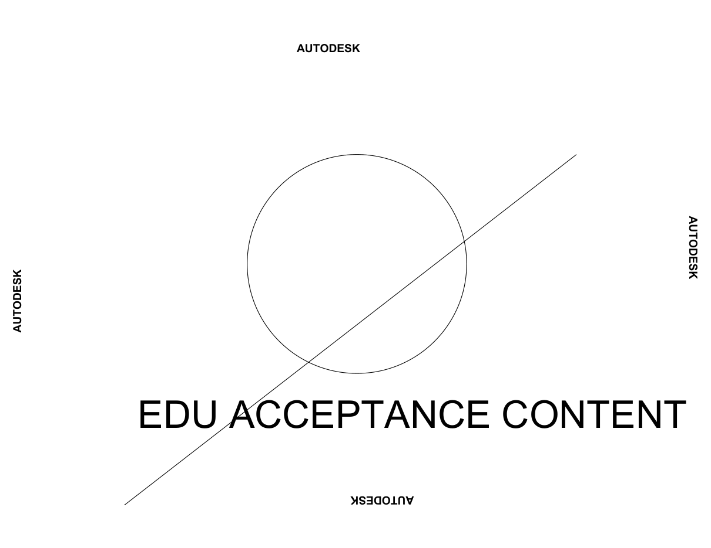

# 清戳验收 · 2026-11-25

## 当前要求：前后版本必须一致（beta.3）

用户明确要求所有处理前后 DWG 格式一致。此前 beta.2 的 2010 → 2018 结果不满足该要求，已被以下验收替代：

| 带戳样本 | 输入 | 成品 | 前后打印 | 重开/内容 |
|---|---|---|---|---|
| JTB 原始 2010 空图 | AC1024 | AC1024 | 带戳 → 未检出 | 成品可重开，仍为空图 |
| 三实体合成图另存 2013 | AC1027 | AC1027 | 带戳 → 未检出 | 线/圆/文字属性一致 |
| 三实体合成图 2018 | AC1032 | AC1032 | 带戳 → 未检出 | 线/圆/文字属性一致 |

清戳内核为 AutoCAD 2022，前后打印及成品重开用 2020。原件 SHA-256 未变，完整数据保存在本地 `dwg-check/edu-version-validation/verified.json`、stripped/、stripped2013/ 和 reopened/。

实现已改为按原版本 SAVEAS 到独立 fixed.dwg；保存标记、文件存在及文件头版本一致后才进行后印和输出。`--verify none` 也执行版本门槛；未知/不支持版本直接失败。历史 deedu 路径也增加按原版本保存及成品版本检查，但仍不推荐用于清戳。

以下为 beta.2 的历史验收记录，保留以说明发现及修复过程。其中“升级为 2018”的行为不再允许，旧截图只作视觉对照。

状态：公开空图及合成有内容样本的自动验收通过，用户已目视确认通过；复杂工程图、参照及多布局仍待扩展。不据此宣布教育版功能全面生产验收通过。

## 样本及原件保护

来源：[JTB World EduFinder](https://jtbworld.com/edufinder) 提供的公开 EduFinderSampleDWGs.zip，仅作为测试输入，不将下载原件提交到 GitHub。

归档 SHA-256：`90f5ba4c439a0c5f34d0ab27871def13fb969c06972838ec65744dc7e997e5b5`。

| 样本 | 处理结果 |
|---|---|
| Drawing with stamp 2010 format.dwg | 前印四边可见 AUTODESK；2022 AUDIT/QSAVE 完成且退出码 0；2020 后印四边未检出；成品重新打开成功 |
| Drawing without stamp 2010.dwg | 本次打印未检出，跳过清戳，不生成去戳成品 |
| CorruptDrawing.dwg | 原件为零字节；前置打印失败，停止，不生成去戳成品 |

三份原件在全部操作后的 SHA-256 与下载时一致。

## 运行方式及证据

使用工作区 .venv，TEMP/TMP 仅在验证会话指向工作区内可读 ASCII 路径。判定及复验均用 AutoCAD 2020，清戳用 AutoCAD 2022，`--verify print --keep-temp --timeout 30`。串行执行。

本地原始证据：`dwg-check/edu-acceptance-2026-11-25/`：

- manifest-before.json：下载来源及原始哈希。
- baseline-fixed/eduprint.json：带戳/无戳/损坏基线。
- stripped/edustrip.json：处理前后判定、内核、退出码、AUDIT/QSAVE 标记、成品路径。
- stripped/打印验收/：前后 PDF/PNG，已由助手查看；带戳样本前四边有文字，后页面空白。
- integrity.json：原件完整性、成品哈希及版本。
- reopened/：清戳前后 DWG 分别重开并导出 DXF，均 0 错误。

包含故意损坏样本的批次退出码为 1，是预期的失败传播；不等于带戳样本处理失败。

## 有内容样本补验

从公开带戳原件复制出 stamped-content.dwg，使用 AutoCAD 2020 在副本中添加一条线、一个圆和一段 TEXT（EDU ACCEPTANCE CONTENT），保存后保留打印戳记。该衍生副本不含客户数据。

再次执行完整前印 → 2022 AUDIT/QSAVE → 2020 后印闭环，退出码 0。前印四边有 AUTODESK，后印四边未见；已查看两张 PNG，线、圆和文字仍可见。前后分别重开导出 DXF，逐项核对线的端点、圆心/半径、文本内容/插入点/字高，3 个模型空间实体完全一致。证据为 content-comparison.json、content-reopened/ 和 content-stripped/。该衍生副本在 2020 重存时已为 AC1032，清戳输出也为 AC1032。

用户于本次会话确认：四边 AUTODESK 消失，线、圆及文字保持正常。此验证不包括代理对象、参照或多布局。

## 验收发现及修复

首次打印产生 PDF 后会话超时。捕获超时前 stdout 发现：打印完成标记已出现，随后 QUIT 等待“是否放弃对图形所做修改”。该修改仅发生在临时副本。

修复打印退出命令，显式确认放弃临时修改；超时保留控制台输出，诊断日志改为 session-plot.log，避免与 AutoCAD 自己的 plot.log 混淆。修复后同一样本打印不再超时。

## 边界

- 公开带戳样本没有设计图元；前后空图重开并不能证明复杂图形、代理对象或打印布局无损。
- 清戳 QSAVE 本次将 AC1024（DWG 2010）升级为 AC1032（DWG 2018）。常规 repair 的保留版本检查不覆盖 edustrip。需要旧格式交付时，必须另行验证，不得暗示本次保持原格式。
- 无戳对照未出现水印，仅证明本次打印条件下未观察到加戳；不据此证明授权状态。
- 用户已确认这对打印图；后续可使用用户指定的工程副本扩展内容、参照及多布局验收。
- 本次退出提示修复及验收记录随 v0.1.0-beta.2 提供；GitHub Actions 不包含 AutoCAD 宿主验证。

## 用户确认的打印对照

以下为公开样本衍生的合成图纸，不含客户数据。

清戳前：

清戳后：

